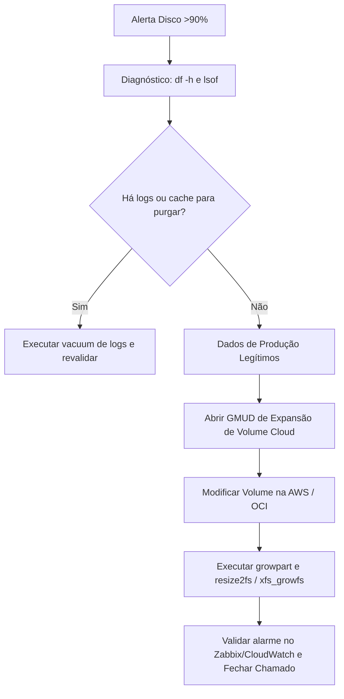

# Runbook 01: Saturação de Armazenamento e Esgotamento de Disco (Linux & Windows)

**Código do Procedimento:** `RBK-OPS-DISK-01`  
**Escopo:** Ambientes Multi-Cloud (AWS EC2, OCI Compute, Azure Virtual Machines)  
**Severidade do Alerta:** P2 (Major - Disco > 90%) / P1 (Crítico - Disco > 95% ou Root Read-Only)  
**Turno:** Operação Noturna e Sustentação Contínua (NOC / CloudOps)  
**Autor:** Cassiano Moura (Cloud Support Associate / NOC Operations)

---

## 1. Gatilho do Incidente & Sintomas
* **Alerta do Sistema de Monitoramento:** Zabbix, Dynatrace ou AWS CloudWatch dispara trigger:
  `High Disk Utilization: Volume /var or / reached 92% on instance i-0abcdef1234567890`.
* **Impacto Operacional:** Riscos de parada de serviço de banco de dados, interrupção de logs, travamento de filas de mensageria e falhas em transações HTTP (500 Internal Server Error).

---

## 2. Fluxo de Investigação & Diagnóstico Imediato (Passo a Passo)

### Passo 2.1 — Conexão Segura
Conectar à instância afetada via **AWS Systems Manager (SSM) Session Manager** ou console de controle OCI/Azure, sem necessidade de chaves SSH expostas na internet:
```bash
aws ssm start-session --target i-0abcdef1234567890
```

### Passo 2.2 — Identificação do Ponto de Montagem e Inodes
```bash
# 1. Verificar utilização do espaço em disco
df -hT

# 2. Verificar se o problema é esgotamento de inodes (muitos arquivos pequenos)
df -i
```

### Passo 2.3 — Localização de Diretórios Ofensores
Executar varredura isolando os maiores consumidores de espaço no sistema de arquivos:
```bash
# Varredura nos diretórios suspeitos (/var, /tmp, /opt)
du -ahx /var | sort -rh | head -n 15

# Varredura em arquivos de log antigos
du -sh /var/log/* | sort -rh | head -n 10
```

### Passo 2.4 — Investigação Forense de "Arquivos Fantasmas" (Deleted but Open)
*Cenário clássico de suporte:* Um operador ou script apagou um arquivo gigante de log (`rm app.log`), mas o processo continuou em execução segurando o file descriptor, impedindo o Linux de liberar os blocos de disco.
```bash
# Identificar processos segurando arquivos deletados
lsof +L1 | sort -k 7 -n -r | head -n 10
```
*Se um processo aparecer com `(deleted)`, o espaço só é liberado reiniciando suavemente o serviço responsável (ver Passo 3.2).*

---

## 3. Ações de Mitigação Padrão (Sem Impacto no Negócio)

### 3.1 Purga de Logs Antigos e Journal do Sistema
```bash
# 1. Reduzir o systemd journal para os últimos 3 dias ou máximo de 200MB
sudo journalctl --vacuum-time=3d
sudo journalctl --vacuum-size=200M

# 2. Limpar cache de pacotes (Ubuntu/Debian/RHEL)
sudo apt-get clean || sudo yum clean all

# 3. Truncar logs em rotação sem deletar os arquivos estruturados
sudo find /var/log/app/ -type f -name "*.log.old" -mtime +7 -delete
```

### 3.2 Reciclar Processo com Arquivo Retido
Caso `lsof +L1` tenha apontado um processo bloqueando espaço (ex: Nginx ou Java):
```bash
# Recarregar configuração sem drop de conexões ativas
sudo systemctl reload nginx
```

---

## 4. Procedimento de Expansão Emergencial (Caso Purga Seja Insuficiente)

Se o disco estiver preenchido por dados legítimos de aplicação que não podem ser expurgados, abrir **GMUD Padrão de Expansão de Volume**:



### Comandos de Expansão de Volume EBS / Block Volume (Online):
```bash
# 1. Na AWS CLI (expande de 50GB para 100GB sem reboot):
aws ec2 modify-volume --volume-id vol-0123456789abcdef0 --size 100

# 2. No Sistema Operacional (estende a partição 1 do dispositivo xvda ou nvme0n1):
sudo growpart /dev/xvda 1

# 3. Estender o sistema de arquivos (conforme tipo de FS):
# Para EXT4:
sudo resize2fs /dev/xvda1

# Para XFS:
sudo xfs_growfs /
```

---

## 5. Critérios de Escalação para o Plantão N3
* Se o sistema de arquivos entrar em modo de proteção **Read-Only** (`Remounting root as read-only`).
* Se houver corrupção física do disco (`I/O errors` no `dmesg`).
* Se a expansão do volume ultrapassar a cota financeira sem autorização prévia da liderança.

---

## 6. Registro no ITSM (Freshservice / ServiceNow)
* **Status:** Resolvido / Em Monitoramento.
* **Categoria:** Infrastructure / Storage / Disk Space.
* **Evidências obrigatórias:** Output do `df -h` antes e depois da intervenção.
* **Ação Preventiva Solicitada:** Ajuste da política do `logrotate` ou criação de alarme proativo em 80%.
