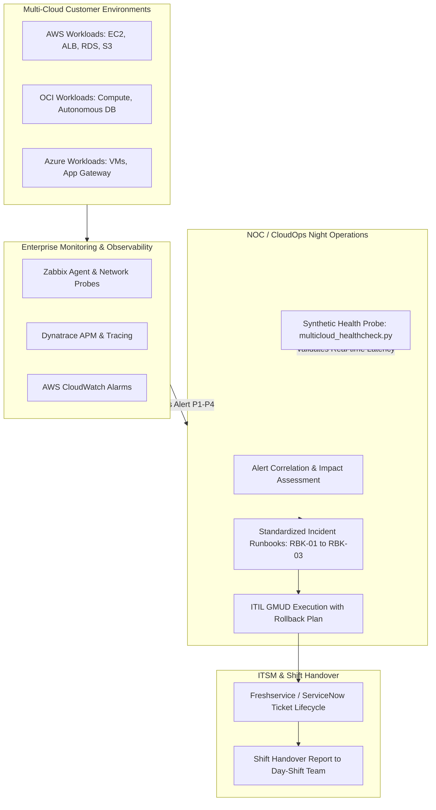

# Multi-Cloud Incident Operations & Enterprise Sustentation Center (AWS • Azure • OCI)

[](https://aws.amazon.com/)
[](https://www.axelos.com/certifications/itil-service-management)
[](https://www.zabbix.com/)
[](https://www.python.org/)
[](https://freshservice.com/)

**Author:** [Cassiano Moura](https://linkedin.com/in/cassianomoura-tech)  
**Specialization:** Cloud Support Associate & Enterprise Technical Support Engineer (Tier 2/3)  
**Portfolio:** [https://cassiano-moura.github.io](https://cassiano-moura.github.io)  
**Target Profile:** Analista de Operações Cloud / Sustentação Multi-Cloud (AWS, OCI, Azure)

---

## 1. Executive Summary & Production Scenario

Enterprise Managed Service Providers (MSPs) and multi-cloud operations teams operate 24/7/365 sustaining mission-critical workloads across **AWS, Azure, and Oracle Cloud Infrastructure (OCI)**. 

During the **Night Shift (23:00 to 08:00)**, operations analysts act as the primary defense line:
1. **Immediate Ownership:** Ingesting and acknowledging monitoring triggers (Zabbix, Dynatrace, CloudWatch) within tight SLA windows (< 15 min).
2. **Autonomous Triage & Runbooks:** Executing standard troubleshooting playbooks to remediate compute, storage, and load balancer failures without unnecessarily waking on-call L3 engineers.
3. **ITIL Change Management (GMUD):** Executing scheduled maintenance changes during off-peak night windows with guaranteed validation and rollback mechanisms.
4. **Structured Shift Handover:** Seamless context transition into the morning shift within ITSM (Freshservice / ServiceNow) with full evidence, eliminating customer re-work.

This repository provides the complete, production-ready operational framework simulating this exact enterprise environment.

---

## 2. End-to-End Operational Workflow



---

## 3. Project Structure & Deliverables

```text
projects/project-5-multicloud-incident-ops-center/
├── README.md                                   # Comprehensive operational architecture
├── scripts/
│   └── multicloud_healthcheck.py               # Multi-cloud synthetic health check engine
├── runbooks/
│   ├── runbook-01-disk-saturation-os-triage.md # P1/P2 Storage saturation & inode triage
│   ├── runbook-02-alb-target-unhealthy-502-504.md # Load balancer & HTTP 502/504 mitigation
│   └── runbook-03-backup-failure-remediation.md # Nightly Commvault / Cloud backup recovery
└── templates/
    ├── gmud_change_request_template.md         # ITIL v4 Change Management with Rollback
    └── shift_handover_report_template.md       # Freshservice structured shift handover
```

---

## 4. Multi-Cloud Synthetic Health Check Engine

The Python diagnostic engine (`scripts/multicloud_healthcheck.py`) runs lightweight synthetic probes to assess operational SLAs across multi-cloud endpoints without requiring complex agents:

### Execution Example:
```bash
python scripts/multicloud_healthcheck.py --demo
```

### CLI Terminal Output:
```text
===============================================================================================
  DEDALUS CLOUD OPERATIONS | MULTI-CLOUD SYNTHETIC HEALTH PROBE REPORT
  Execution Time: 2026-10-22 14:34:58 UTC | Operator: Cassiano Moura
===============================================================================================
CLOUD    | TARGET NAME                | TYPE     | STATUS    | LATENCY    | CODE/DETAIL
-----------------------------------------------------------------------------------------------
AWS      | AWS Production ALB HealthCheck | HTTP     | HEALTHY   | 182.9 ms   | HTTP 200
OCI      | OCI Cloud Infrastructure Portal | HTTP     | HEALTHY   | 231.9 ms   | HTTP 200
Azure    | Azure Global Identity Endpoint | HTTP     | HEALTHY   | 266.1 ms   | HTTP 200
AWS      | AWS Portfolio Web Uptime Check | HTTP     | HEALTHY   | 250.8 ms   | HTTP 200
GCP      | Public DNS Gateway (Google) | TCP_PORT | HEALTHY   | 47.8 ms    | Port 53
MULTI    | Cloudflare Secure Edge DNS | TCP_PORT | HEALTHY   | 28.1 ms    | Port 53
===============================================================================================
Summary: 6 targets scanned | 6 HEALTHY | 0 DEGRADED | 0 CRITICAL
===============================================================================================
```

### JSON Mode for ITSM / Splunk Ingestion:
```bash
python scripts/multicloud_healthcheck.py --json
```

### Running Automated Test Suite:
```bash
python -m unittest tests/test_healthcheck.py
```

---

## 5. Enterprise Runbooks (Standard Operating Procedures)

1. **[Runbook 01: Storage Saturation & Disk Triage (Linux/Windows)](runbooks/runbook-01-disk-saturation-os-triage.md):**
   - Diagnosis using `df -hT`, `df -i`, `du -ahx`, and investigation of deleted files holding disk space (`lsof +L1`).
   - Standard mitigation via `journalctl --vacuum-time=3d` and automated live EBS volume expansion (`growpart` + `resize2fs`).
2. **[Runbook 02: Load Balancer Unhealthy Target & HTTP 502/504](runbooks/runbook-02-alb-target-unhealthy-502-504.md):**
   - Distinction between HTTP 502 (backend crash/reset) and HTTP 504 (gateway timeout / database lock).
   - Target Group inspection via AWS CLI and graceful process worker recycling.
3. **[Runbook 03: Multi-Cloud Backup Routine Failure (Commvault / AWS Backup)](runbooks/runbook-03-backup-failure-remediation.md):**
   - Triage of nightly backup failures during the critical 01:00-04:30 window.
   - Volume Shadow Copy (VSS) provider remediation and on-demand recovery triggers.

---

## 6. ITIL Governance: GMUD & Shift Handover

* **[Formal GMUD Change Request Template](templates/gmud_change_request_template.md):**
  - Includes business rationale, risk classification, zero-downtime execution steps, verification probes, and a **mandatory step-by-step Rollback Plan**.
* **[Shift Handover Report Template](templates/shift_handover_report_template.md):**
  - Designed for Freshservice/ServiceNow ticket updates, ensuring incoming day-shift analysts receive full context, logs, and pending actions without customer repetition.

---

## 7. Author & Technical Credentials

**Cassiano Moura**  
*Cloud Support Associate & Enterprise Technical Support Engineer*  
* **Official Community Leader:** AWS User Group Leader Canoas  
* **Certifications:** AWS Certified Cloud Practitioner (CLF-C02), Oracle Data Platform Foundations Associate, MySQL HeatWave Implementation Certified Associate  
* **Languages:** English (C1 IELTS Fluent) | Spanish (B2 Professional) | Portuguese (Native)  
* **LinkedIn:** [linkedin.com/in/cassianomoura-tech](https://linkedin.com/in/cassianomoura-tech)  
* **Email:** [cassiano.moura.tech@gmail.com](mailto:cassiano.moura.tech@gmail.com)
