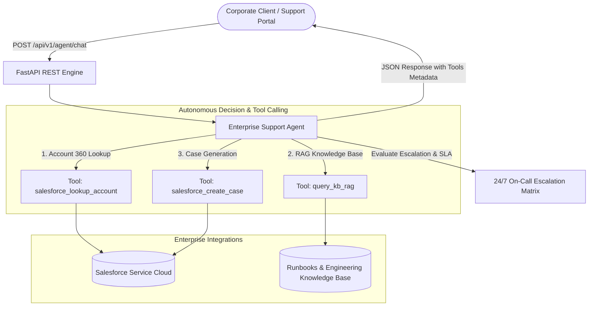

# Enterprise AI Support Agent (Python, FastAPI & Salesforce Integration)


-brightgreen)

An enterprise-grade autonomous AI Agent designed for high-availability corporate customer support and mission-critical cloud incident triage. 

Built strictly with **Python**, **FastAPI**, **LLM Tool/Function Calling**, **Retrieval-Augmented Generation (RAG)**, and seamless integration with **Salesforce Service Cloud REST APIs**.

---

## 1. Architectural Highlights & Features



- **Pydantic Data Contracts:** Strict validation and serialization for all customer payloads, tool executions, and Salesforce sObjects.
- **Dynamic Tool / Function Calling:** The agent autonomously executes multi-step workflows:
  1. `salesforce_lookup_account`: Identifies contract tiers (Mission Critical vs Standard) and SLA limits (1h vs 4h).
  2. `query_kb_rag`: Retrieves relevant runbooks for technical triage (e.g. ALB 502/504 errors, disk saturation).
  3. `salesforce_create_case`: Instantly creates official support cases in Salesforce with calibrated severity.
- **Automated Human Escalation:** Automatically routes P1/Critical incidents to on-call engineers when SLAs dictate immediate intervention.
- **Full OpenAPI / Swagger Documentation:** Interactive testing interface at `/docs`.

---

## 2. Directory Structure

```bash
project-6-enterprise-salesforce-ai-agent/
├── app/
│   ├── api/
│   │   └── v1/
│   │       └── endpoints.py          # FastAPI routes (/agent/chat, /salesforce/cases)
│   ├── core/
│   │   └── config.py                 # Pydantic BaseSettings environment manager
│   ├── schemas/
│   │   └── agent_schema.py           # Pydantic Request/Response models & enums
│   ├── services/
│   │   ├── agent_service.py          # AI Agent with Tool Execution & RAG engine
│   │   └── salesforce_service.py     # Salesforce REST API client simulation
│   └── main.py                       # FastAPI application entrypoint & middleware
├── tests/
│   ├── test_agent_core.py            # Automated test suite (Mocked Salesforce & RAG)
│   └── test_agent_api.py             # Async HTTP API client tests
├── requirements.txt                  # Production dependencies
└── README.md                         # Architecture documentation
```

---

## 3. Quickstart & Execution

### 1. Install Dependencies
```bash
pip install -r requirements.txt
```

### 2. Run the FastAPI Application
```bash
python -m uvicorn app.main:app --host 0.0.0.0 --port 8000 --reload
```
Navigate to `http://localhost:8000/docs` to test via Swagger UI.

### 3. Run Automated Tests
```bash
python -m unittest tests/test_agent_core.py
```

---

## 4. API Request / Response Example

### Request (`POST /api/v1/agent/chat`):
```json
{
  "customer_id": "customer@acmecorp.com",
  "message": "Nossos servidores em produção estão com erro 502 urgente no load balancer!"
}
```

### Response (`200 OK`):
```json
{
  "reply": "Olá! Identifiquei um incidente operacional reportado. Registrei imediatamente o Caso #004021 no Salesforce Service Cloud com prioridade Critical.\n\nSua conta está classificada como Mission Critical Enterprise com SLA de resposta garantido de até 1h.\n\nTriagem Inicial Sugerida (Base de Conhecimento):\nHTTP 502 indicates the load balancer failed to receive a valid response from backend targets...",
  "intent_detected": "incident_report",
  "confidence_score": 0.95,
  "tools_executed": [
    {
      "tool_name": "salesforce_lookup_account",
      "arguments": {"email": "customer@acmecorp.com"},
      "result": {"account_id": "0015g00000XyZ1AAAZ", "name": "Acme Global Enterprise", "tier": "Mission Critical Enterprise"},
      "status": "success"
    },
    {
      "tool_name": "query_kb_rag",
      "arguments": {"query": "..."},
      "result": {"found": true},
      "status": "success"
    },
    {
      "tool_name": "salesforce_create_case",
      "arguments": {"priority": "Critical"},
      "result": {"case_number": "004021", "status": "New"},
      "status": "success"
    }
  ],
  "escalated_to_human": true,
  "session_id": "sess_f8391a2e7c"
}
```

---

## 5. Author & Contact
* **Cassiano Moura** — AI & Cloud Operations Engineer
* **Official Community Leader:** AWS User Group Leader Canoas
* **LinkedIn:** [linkedin.com/in/cassianomoura-tech](https://linkedin.com/in/cassianomoura-tech)
* **Portfolio:** [cassiano-moura.github.io](https://cassiano-moura.github.io)
